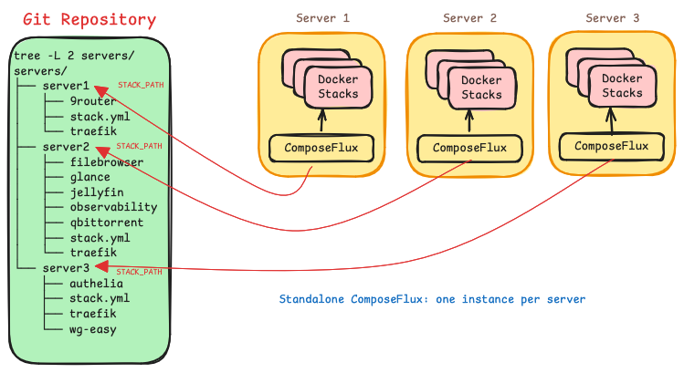
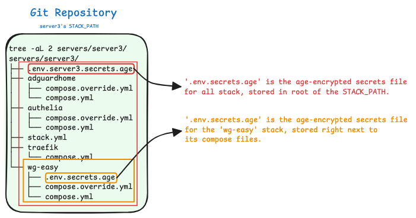
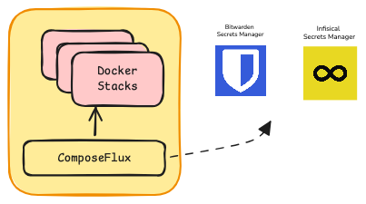

# Overview

ComposeFlux is a GitOps continuous deployment tool for Docker Compose. It reconciles Docker stacks on a host from a Git
repository.

## Introduction

ComposeFlux reconciles the Docker stacks located under a path (`STACK_PATH`) in a Git repository, authenticating with a
deploy key. It is standalone: there is no central management service, UI, or database. Managing stacks on a host
therefore means running ComposeFlux on that host and pointing `STACK_PATH` at the directory that holds those stacks.

## Structure

Stacks are organized into directories under `STACK_PATH`, ideally one directory per server.

### Stack Path

`STACK_PATH` defines where ComposeFlux looks for stacks. The stacks must be flat: ComposeFlux scans that directory for
drift and reconciles the stacks found in it.

The image below shows multiple standalone ComposeFlux instances running on different servers, all pointing at the same
Git repository with different `STACK_PATH` values.



### Stacks

A stack is a Docker Compose directory that contains a Compose file and its related configuration, including an optional
Age vault.

```
stacks/                     STACK_PATH
├── stack.yml               optional shared configuration
├── shared.env.age          optional secrets for every stack
├── traefik/
│   ├── compose.yml
│   └── traefik.env.age     optional secrets for this stack
├── nextcloud/
│   └── compose.yml
└── jellyfin/
    └── docker-compose.yml
```

During reconciliation, ComposeFlux lists the directories in `STACK_PATH` and looks for `compose.yaml`, `compose.yml`,
`docker-compose.yml`, or `docker-compose.yaml`, plus a matching override file. Directories without a Compose file are
ignored. Discovery is one level deep: nested directories are not scanned on their own. A stack can still be
[modularized or include](https://docs.docker.com/reference/compose-file/include/) another Compose file, provided the
referenced files are inside the same repository. Remote includes are ignored, and paths that escape the repository are
rejected.

!!! warning "The project name must match the directory name"

    Do not set a `name:` in the Compose file that differs from the stack directory name. ComposeFlux treats the
    directory name as the Compose project name and rejects a project whose resolved name differs.

## Stack configuration

An optional `stack.yml` in `STACK_PATH` controls deployment order and defines environment variables shared by all
stacks. The file name is configurable with `CONFIG_FILE` and is resolved relative to `STACK_PATH`.

```yaml
startup_order:
  - traefik

envs:
  DOMAIN: homeserver.local
  TZ: America/New_York
  ENVIRONMENT: production
```

- `startup_order` lists stacks that must deploy first. The remaining stacks deploy afterwards in no guaranteed order.
- `envs` are available for Compose interpolation in every stack.
- Names in `startup_order` must match directory names. Unknown names are reported in the log and skipped.
- A missing `stack.yml` is allowed. A malformed or unreadable file stops the current reconciliation pass.

## Background Operations

### Health reconciliation

Set `HEALTH_RECONCILE_INTERVAL` to enable periodic health checks; they are disabled by default. When enabled,
ComposeFlux redeploys any managed stack that contains an unhealthy container. Git is not pulled for this recovery.

A container is healthy when either of these is true:

- The container is running and its health status is not `unhealthy`.
- The container has exited with code `0` and carries the `composeflux.init: "true"` label, which marks a one-shot or
  init container as an expected exit.

Every other state is unhealthy, including `restarting`, `paused`, `dead`, and `exited` without the init label. A stack
is unhealthy when any of its containers is unhealthy. After three consecutive failed deployments, ComposeFlux stops
trying the stack until the next successful Git sync or image update.

### Automatic image updates

Set `IMAGE_UPDATE_SCHEDULE` to a cron expression to check for new images. ComposeFlux compares the local and remote
image digests for each stack. When a newer digest is available, it pulls the images and redeploys the stack. Images
built locally or pinned by digest are skipped, and an image that is missing locally is treated as needing an update.

Add `composeflux.image-update.exclude: "true"` to any service to exclude the stack. If a scheduled check is still
running, the next invocation is skipped.

### Resource pruning

`PRUNE_INTERVAL` defaults to `24h`. Set it to `0` to disable pruning.

!!! warning "Pruning applies to the whole Docker host"

    Pruning is not limited to ComposeFlux stacks. It removes all unused volumes, all dangling images, and all build
    cache. Containers and networks are not pruned.

Pruning runs only when every stack under `STACK_PATH` is running in Docker, healthy, and not suspended. Otherwise the
cycle is skipped and a warning is logged.

## Secrets

ComposeFlux supports two secret sources, which can be used together:

- **Offline secrets**: age-encrypted dotenv files (`*.age`) stored in the Git repository and decrypted in memory.
- **Remote secrets**: Bitwarden Secrets Manager or Infisical. Only one remote provider can be configured.

### Offline Secrets

!!! note

    Only [age](https://github.com/FiloSottile/age) with passphrase encryption is supported. Files with the `.age`
    extension are discovered automatically and decrypted with `AGE_PASSPHRASE` (`--age-passphrase`).

Offline secrets are dotenv files encrypted with a passphrase and committed to the stack repository. During
reconciliation ComposeFlux discovers the `*.age` files that apply to a stack, decrypts each one in memory, parses it as
dotenv, and exports the keys as environment variables for Compose interpolation while the stack is brought up.
Plaintext is never written to disk, and the keys are available to the Compose file for interpolation only.

A `.age` file inside a stack directory provides secrets for that stack. A `.age` file in the root of `STACK_PATH`
provides secrets for every stack in that stack path, that is, shared secrets.

Create a dotenv file containing the values to encrypt:

```bash
TOKEN=my-token
```

Encrypt it with a passphrase and remove the plaintext file:

```bash
age -p -o .env.secrets.age .env_secrets
rm .env_secrets
```

The encrypted file is kept next to the stack it belongs to:

```
servers/wg1-ams/wg-easy/
├── .env.secrets.age
├── compose.override.yml
└── compose.yml
```



The Compose file references the exported keys:

```yaml
name: wg-easy

services:
  wg-easy:
    image: ghcr.io/wg-easy/wg-easy:latest
    environment:
      TOKEN: ${TOKEN} # decrypted from the .age vault and exported while bringing up the stack
```

See [Offline Secrets with Age](how-to-guides/AgeSecrets.md) for the full workflow.

### Remote secrets

!!! note

    Only [Bitwarden Secrets Manager](https://bitwarden.com/help/secrets-manager-overview/) and
    [Infisical](https://infisical.com/docs) are supported as remote providers.

One remote provider can be configured at a time. Values are fetched whenever ComposeFlux reconciles a stack. After
changing a secret in the provider, run `composeflux sync` to apply it.



ComposeFlux does not inject every secret into every container. A value reaches a container only when the Compose service
references it:

```yaml
services:
  app:
    image: myapp:latest
    environment:
      DATABASE_PASSWORD: ${DATABASE_PASSWORD}
```

- [Bitwarden Secrets Manager (How-to Guide)](how-to-guides/Bitwarden.md)
- [Infisical Secrets Manager (How-to Guide)](how-to-guides/Infisical.md)

## Git checkout ownership

!!! warning

    Git is the source of truth for the checkout at `GIT_CLONE_PATH`. Before the startup checkout and before each sync,
    ComposeFlux discards local changes to tracked files and logs the affected paths. This includes changes written by
    containers through bind mounts. Untracked files are preserved, but a file required by the target revision can be
    replaced. Mutable application data must stay outside tracked files.

## Labels

ComposeFlux adds `composeflux.managed`, `composeflux.version`, and `composeflux.deployed-at` labels to every service
during deployment. The managed label can be used to list stacks:

```bash
docker ps --filter "label=composeflux.managed=true"
```

Besides the labels added by ComposeFlux, services can carry labels that control reconciliation.

### Suspend

`composeflux.health.suspend`

When this label is set on any service in the Compose file, ComposeFlux stops managing the stack: no Git deployment,
health recovery, or image updates, and the resource prune cycle is skipped.

Example

```yaml
---
name: actualbudget
services:
  actualbudget:
    image: docker.io/actualbudget/actual-server:latest
    container_name: actualbudget
    restart: unless-stopped
    labels:
      - composeflux.health.suspend=true
    hostname: actualbudget
```

### Init

`composeflux.init`

When [health reconciliation](#health-reconciliation) is enabled, a
[one-shot container](https://docs.docker.com/compose/how-tos/init-containers) in a stack can be marked so that
ComposeFlux does not treat its exit as a failure. Add this label to the service.

Example

```yaml
---
name: valkey
services:
  init-change-ownership: # one-shot container
    image: busybox:latest
    labels:
      - composeflux.init=true # health checks succeed even though this container exits with code 0
    volumes:
      - valkey_data:/tmp/change-ownership
    environment:
      PUID: ${PUID}
      PGID: ${PGID}
    command: chown -R ${PUID}:${PGID} /tmp/change-ownership

  valkey:
    image: valkey/valkey:8-alpine
    container_name: valkey
    depends_on:
      init-change-ownership:
        condition: service_completed_successfully
    volumes:
      - valkey_data:/data
    user: ${PUID}:${PGID}
    hostname: valkey
volumes:
  valkey_data:
    name: valkey_data
```

### Exclude Image Update

`composeflux.image-update.exclude`

This label excludes a stack from automatic image updates.

Example

```yaml
---
name: actualbudget
services:
  actualbudget:
    image: docker.io/actualbudget/actual-server:latest
    container_name: actualbudget
    restart: unless-stopped
    labels:
      - composeflux.image-update.exclude=true
    hostname: actualbudget
```

## Limitations

- Stack discovery is one level deep.
- No central controller or multi-server orchestration.
- No rolling updates or zero-downtime deployments.
- No built-in monitoring or alerting.
