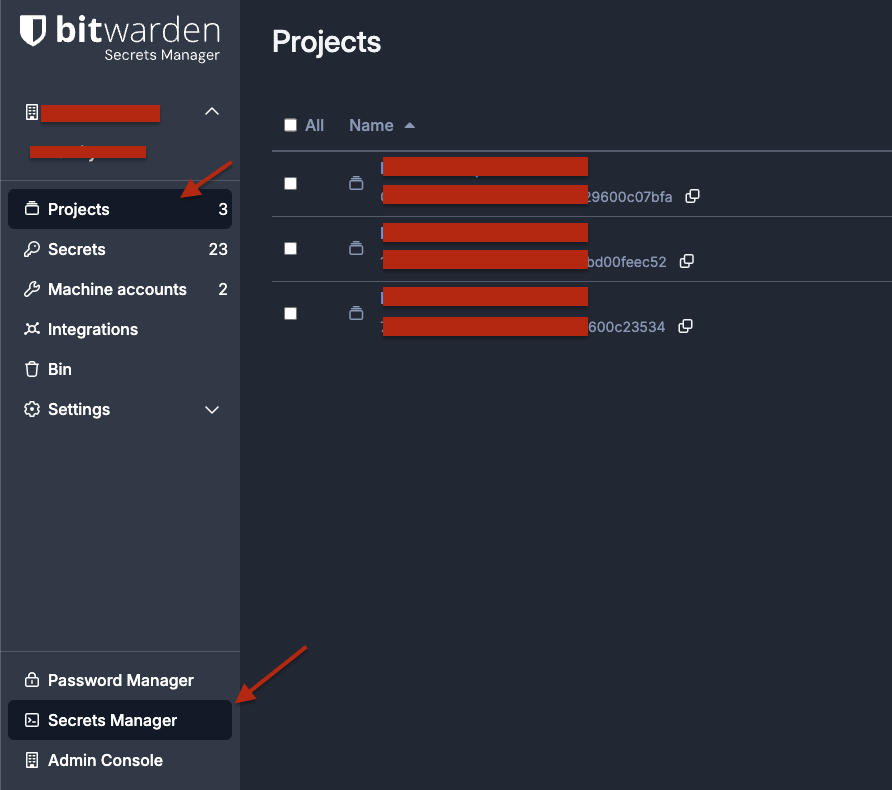
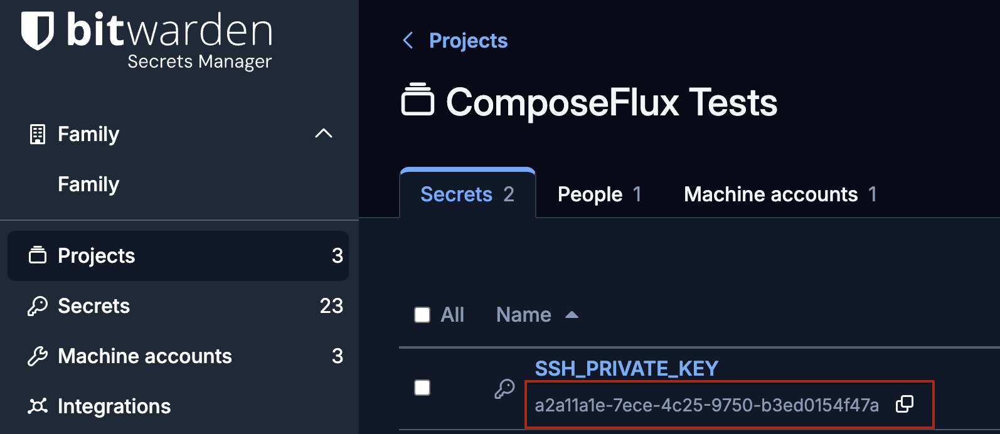
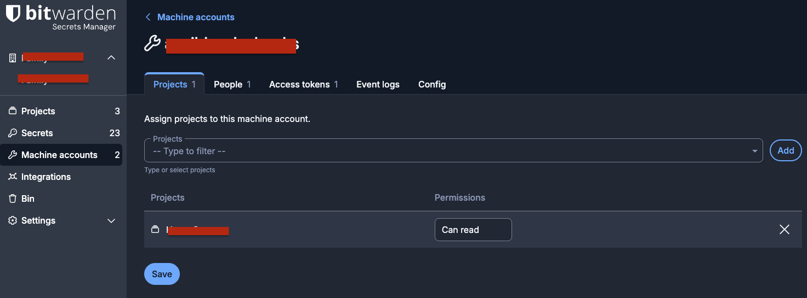
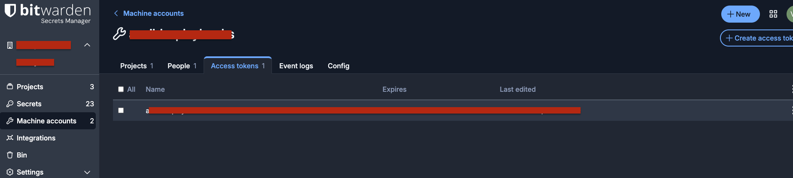
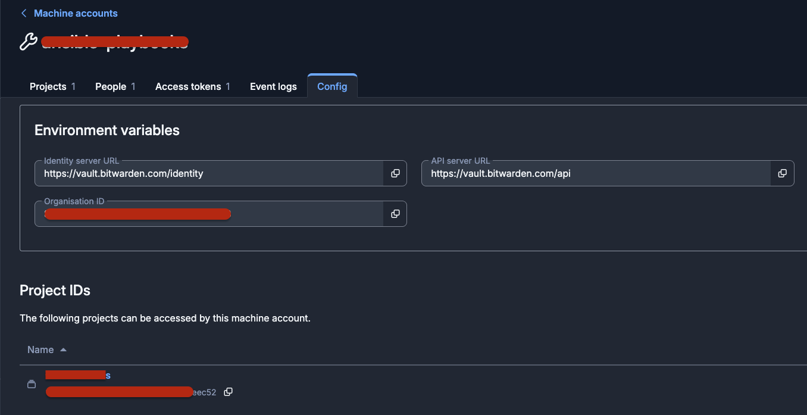

# Bitwarden Secrets Manager

Configure [Bitwarden Secrets Manager](https://bitwarden.com/help/secrets-manager-overview/) as a remote secrets
provider. ComposeFlux fetches every secret in the configured project and exposes each value under its secret key name.

## 1. Create a project

1. Sign in to Bitwarden.
2. Open **Secrets Manager**.
3. Click **New Project** and create a project for ComposeFlux.



## 2. Add secrets

Add the keys referenced by the stacks, for example `DATABASE_URL` or `API_KEY`.

To fetch the Git deploy key from Bitwarden, create a secret that contains the private key and copy its secret ID. See
[Store the key in a secrets manager](GithubDeployKeys.md#store-the-key-in-a-secrets-manager).



## 3. Create a machine account

1. Open the **Machine Accounts** tab.
2. Click **New Machine Account**.
3. Assign the project created above.
4. Set the permission to **Can read**.
5. Click **Save**.



## 4. Create an access token

1. Open the machine account.
2. Open the **Access tokens** tab.
3. Click **Create access token**.
4. Copy the token and store it securely.



## 5. Configure ComposeFlux

Set the following values. The organization ID, project ID, API URL, and identity URL are shown in the machine account
configuration.



```bash
BITWARDEN_ACCESS_TOKEN=<access-token>
BITWARDEN_ORGANIZATION_ID=<organization-id>
BITWARDEN_PROJECT_ID=<project-id>

# Optional: only when fetching the SSH deploy key from Bitwarden
GIT_DEPLOY_KEY_SECRET_REF=<secret-id>

# Optional: only for self-hosted Bitwarden
# BITWARDEN_API_URL=https://vault.bitwarden.com/api
# BITWARDEN_IDENTITY_URL=https://vault.bitwarden.com/identity
```

## Use the values

Reference the keys in a stack's Compose file:

```yaml
services:
  app:
    image: myapp:latest
    environment:
      DATABASE_URL: ${DATABASE_URL}
      API_KEY: ${API_KEY}
```

Keys that are not referenced are not passed to containers. After changing a secret in Bitwarden, run
`composeflux sync` to apply it.
