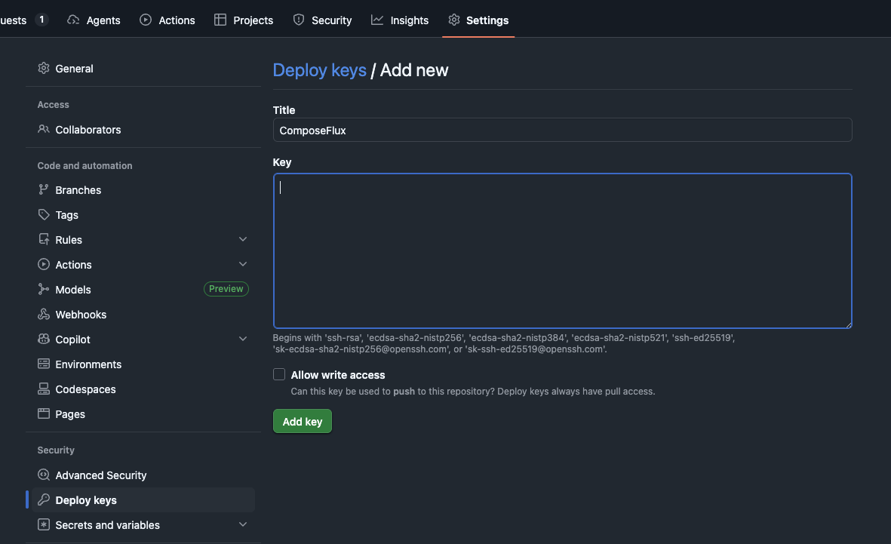

# GitHub Deploy Keys

A deploy key gives ComposeFlux read-only SSH access to the stacks repository. The same approach works with other Git
providers.

## Generate a key pair

```bash
ssh-keygen -t ed25519 -C "composeflux-deploy-key" -f ~/.ssh/composeflux_deploy
```

This creates the private key `~/.ssh/composeflux_deploy` and the public key `~/.ssh/composeflux_deploy.pub`. Do not
set a passphrase; ComposeFlux runs unattended.

## Add the public key to GitHub

1. Copy the public key:

    ```bash
    cat ~/.ssh/composeflux_deploy.pub
    ```

2. Open the repository on GitHub.
3. Go to **Settings**, then **Deploy keys**, and click **Add deploy key**.
4. Paste the key and leave write access disabled.



## Provide the private key to ComposeFlux

Use one of the following options.

### Mount the key

Mount the private key at `GIT_SSH_KEY_PATH`. The default path is `/.ssh/composeflux_id_rsa`.

```yaml
services:
  composeflux:
    image: ghcr.io/veerendra2/composeflux:latest
    environment:
      GIT_REPO_URL: git@github.com:user/repo.git
      STACK_PATH: stacks
    volumes:
      - /var/run/docker.sock:/var/run/docker.sock
      - ~/.ssh/composeflux_deploy:/.ssh/composeflux_id_rsa:ro
      - compose-stack:/opt/compose-stack

volumes:
  compose-stack:
```

### Store the key in a secrets manager

This option requires Bitwarden or Infisical credentials. Set `GIT_DEPLOY_KEY_SECRET_REF` to the secret reference:

- **Bitwarden**: the secret ID.
- **Infisical**: the secret key name, for example `SSH_PRIVATE_KEY`.

At startup, ComposeFlux fetches the value and writes it to `GIT_SSH_KEY_PATH` with mode `0600`. When the reference is
empty, ComposeFlux uses the key already present at that path.

```yaml
environment:
  GIT_REPO_URL: git@github.com:user/repo.git
  STACK_PATH: stacks
  GIT_DEPLOY_KEY_SECRET_REF: SSH_PRIVATE_KEY
  INFISICAL_CLIENT_ID: ${INFISICAL_CLIENT_ID}
  INFISICAL_CLIENT_SECRET: ${INFISICAL_CLIENT_SECRET}
  INFISICAL_ENVIRONMENT: prod
  INFISICAL_PROJECT_ID: ${INFISICAL_PROJECT_ID}
```

See [Bitwarden](Bitwarden.md#2-add-secrets) or [Infisical](Infisical.md#3-add-secrets) for adding the secret.

## Test access

```bash
ssh -i ~/.ssh/composeflux_deploy -T git@github.com
```

A successful test prints a message that the key authenticated but does not provide shell access.
