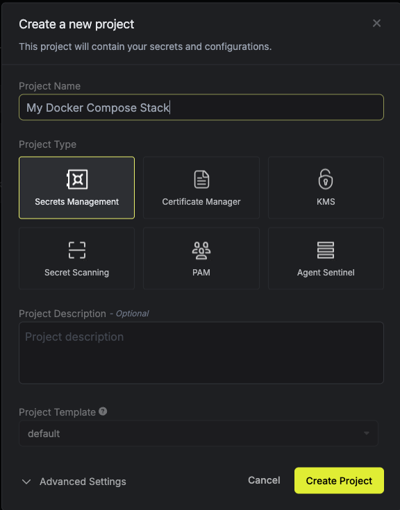
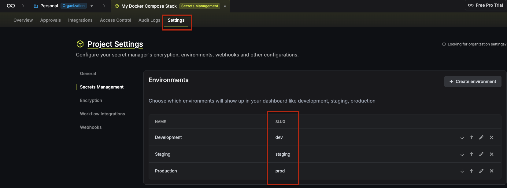
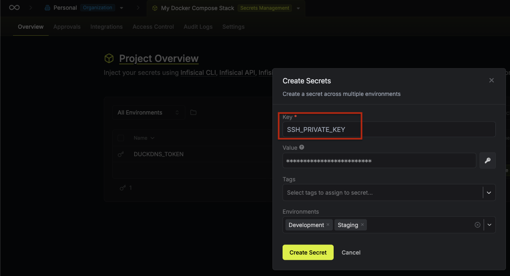
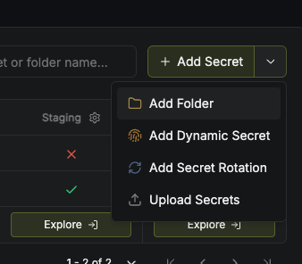
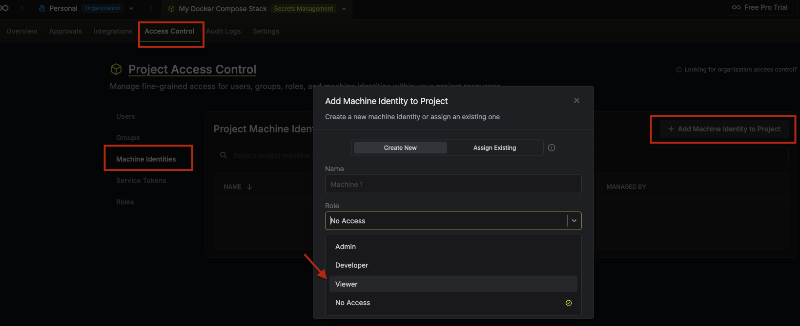
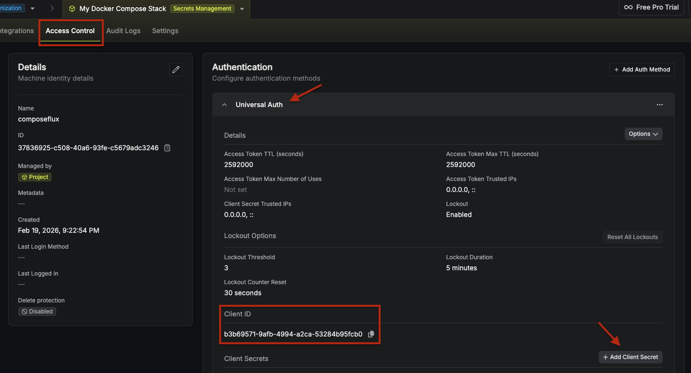
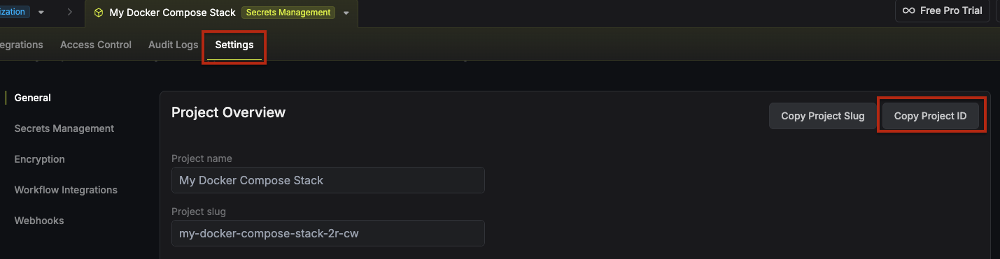

# Infisical Secrets Manager

Configure [Infisical](https://infisical.com/docs) as a remote secrets provider. ComposeFlux fetches secrets from the
configured project, environment, and paths, and exposes each value under its secret key name.

## 1. Create a project

1. Sign in to Infisical.
2. Open the **Overview** tab.
3. Click **Add New Project** and create a project for ComposeFlux.



## 2. Choose an environment

ComposeFlux uses `INFISICAL_ENVIRONMENT`, so an environment slug is required.

1. Open the project.
2. Create or select an environment, for example `prod`.
3. Note the environment slug.



## 3. Add secrets

Add the keys referenced by the stacks, for example `DATABASE_PASSWORD` or `API_KEY`.

To fetch the Git deploy key from Infisical, create a secret named `SSH_PRIVATE_KEY` and copy the private key content.
See [Store the key in a secrets manager](GithubDeployKeys.md#store-the-key-in-a-secrets-manager).



## 4. Optional: organize secrets in folders

Set `INFISICAL_SECRET_PATH` to the folder used by ComposeFlux. The default is `/`.

Use a comma-separated list to read secrets from several folders, for example `/generic,/apps/prod`:

- If a path cannot be read, ComposeFlux logs a warning and continues with the other paths.
- If every path fails, the fetch fails.
- If the same key exists in several paths, the last path's value takes precedence.

A common layout is shared secrets in `/generic` and environment overrides in `/apps/prod`.



## 5. Create a machine identity

1. Open **Project Settings**, then **Access Control**, then **Machine Identities**.
2. Click **Add Machine Identity to Project**.
3. Enter a name and set the role to **Viewer**.



## 6. Create client credentials

1. Open the machine identity.
2. In the **Authentication** tab, expand **Universal Auth**.
3. Click **Add Client Secrets**.
4. Copy the client ID and client secret.



## 7. Configure ComposeFlux

```bash
INFISICAL_CLIENT_ID=<client-id>
INFISICAL_CLIENT_SECRET=<client-secret>
INFISICAL_ENVIRONMENT=prod
INFISICAL_PROJECT_ID=<project-id>

# Optional
# INFISICAL_SECRET_PATH=/
# INFISICAL_SITE_URL=https://app.infisical.com
# GIT_DEPLOY_KEY_SECRET_REF=SSH_PRIVATE_KEY
```

The project ID is shown in the project settings.



## Use the values

Reference the keys in a stack's Compose file:

```yaml
services:
  app:
    image: myapp:latest
    environment:
      DATABASE_PASSWORD: ${DATABASE_PASSWORD}
      API_KEY: ${API_KEY}
```

Keys that are not referenced are not passed to containers. After changing a secret in Infisical, run
`composeflux sync` to apply it.
